

  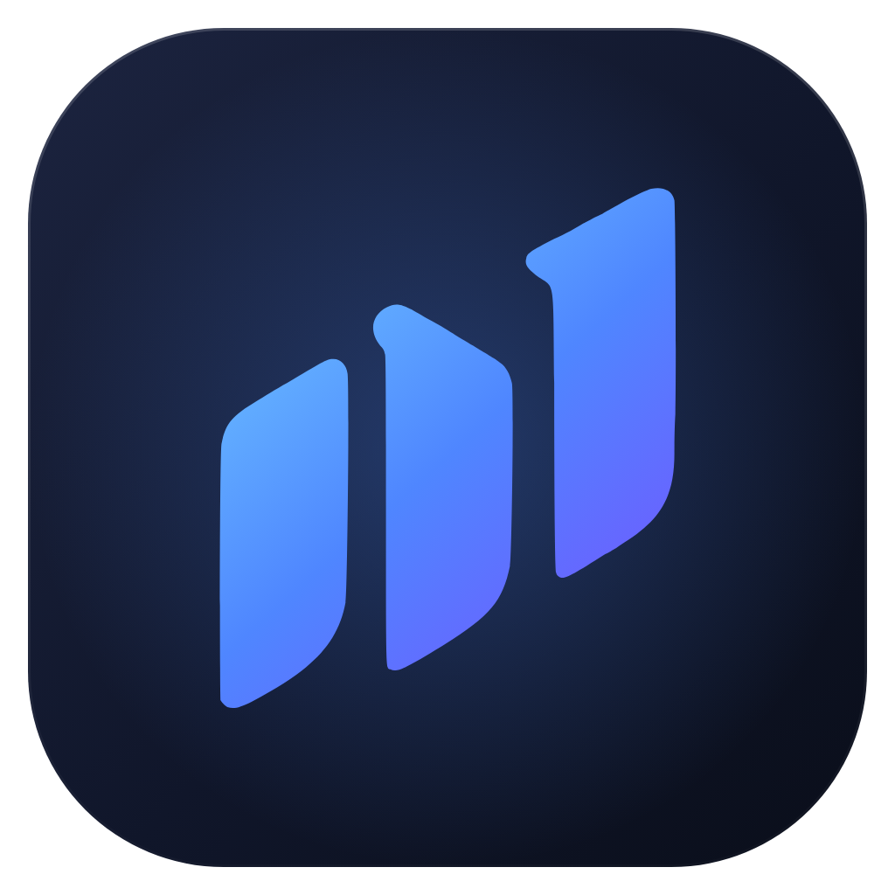

<h1 align="center">Investa</h1>

  Aplicativo para Windows e Android que ajuda a aprender a investir e a organizar as finanças pessoais.

  
  

  
  

<picture>
  <source media="(prefers-color-scheme: dark)" srcset="docs/media/capa-escuro.png">
  <source media="(prefers-color-scheme: light)" srcset="docs/media/capa-claro.png">
  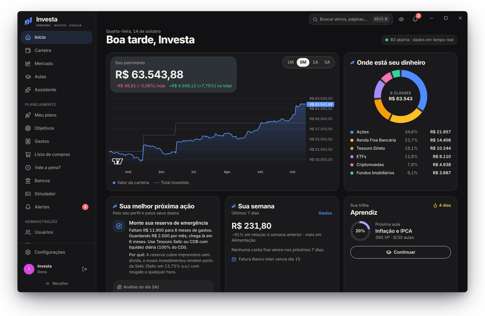
</picture>

## Sobre o projeto

O Investa é um projeto pessoal e pequeno, feito por um desenvolvedor iniciante para uso próprio e como forma de aprender programação. Ele junta num lugar só o que eu precisava no dia a dia: aulas curtas sobre investimentos, cotações do mercado, controle de gastos e faturas, metas e uma lista de compras.

Não é um produto comercial, não tem anúncios e não vende nada. O conteúdo é educativo e **não é recomendação de investimento**.

## Privacidade

- **Seus dados são só seus.** Cada conta só consegue ler e alterar os próprios dados. Nenhum outro usuário do app vê o que você cadastra.
- **Sem a sincronização ligada, tudo fica no seu aparelho.** Com ela ligada, os dados vão para um banco de dados protegido por regras de acesso por conta, para aparecer no PC e no celular.
- **Senhas** são guardadas com criptografia (hash), nunca em texto puro.
- **Assistente:** quando você faz uma pergunta, ela é enviada ao serviço de IA junto com os dados necessários para responder. As outras telas não mandam nada seu para fora.
- Cotações, juros e notícias vêm de fontes públicas (Yahoo Finance, Banco Central, Tesouro Direto e portais de notícias).

## O que o app faz

| Tela | O que faz |
|---|---|
| Início | Patrimônio, divisão da carteira, objetivos, indicadores do dia (Selic, CDI, IPCA, dólar, Ibovespa) e notícias |
| Aulas | 30 aulas curtas em 10 módulos, do básico até montar uma carteira, com quiz, XP e glossário |
| Mercado | Ações, FIIs, ETFs, BDRs, Tesouro Direto, renda fixa, cripto, moedas, índices e commodities, com gráficos |
| Carteira | Seus investimentos em renda variável e renda fixa, com rendimento atualizado |
| Gastos | Lançamentos por categoria e cartão, parcelas, faturas, contas fixas e quanto ainda dá para gastar no mês |
| Lista de compras | Itens do mercado com quantidade e preço, total da lista e exportação |
| Objetivos | Metas com valor e prazo, projeção com os juros atuais e caixinhas automáticas |
| Meu plano | Um plano para chegar no seu objetivo, com projeção e checklist |
| Vale a pena? | Preço de um produto ou jogo e se a compra cabe no seu mês |
| Assistente | Chat de IA que explica investimentos e ajuda com o orçamento usando os seus números |
| Bancos | Comparação de bancos e corretoras e juros de crédito do Banco Central |
| Simulador | R$ 100 mil virtuais para treinar compra e venda com preços reais |
| Alertas | Avisos de preço, de datas do mercado e de contas a vencer |

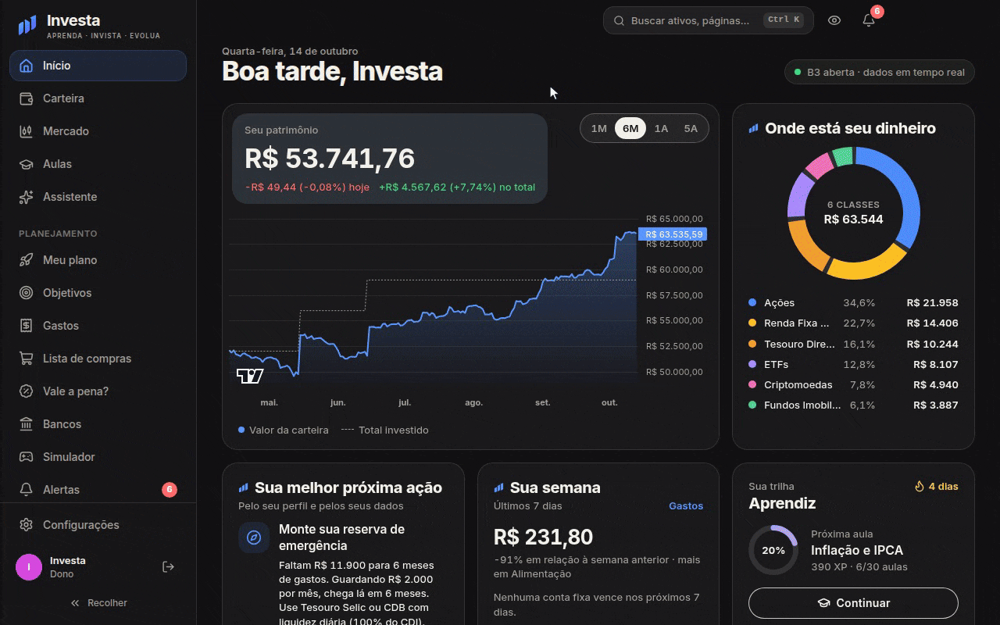

  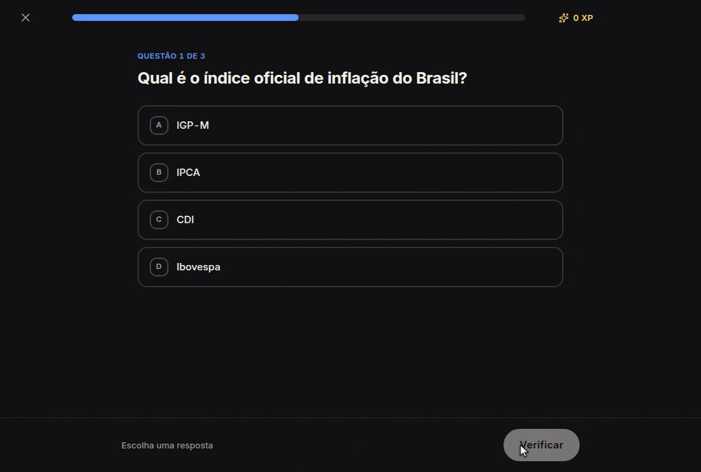

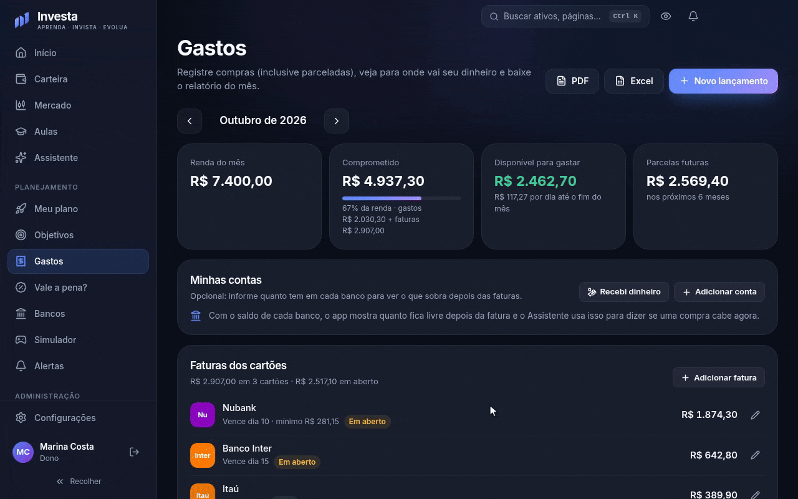

### No celular

O app Android tem as mesmas telas do Windows, com a navegação adaptada para a tela pequena. Dá para escolher quais telas ficam na barra de baixo.

  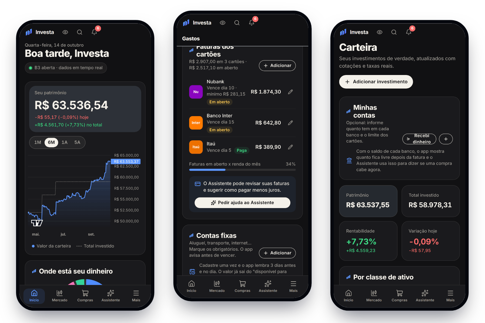

### Mais telas

<table>
  <tr>
    <td width="50%">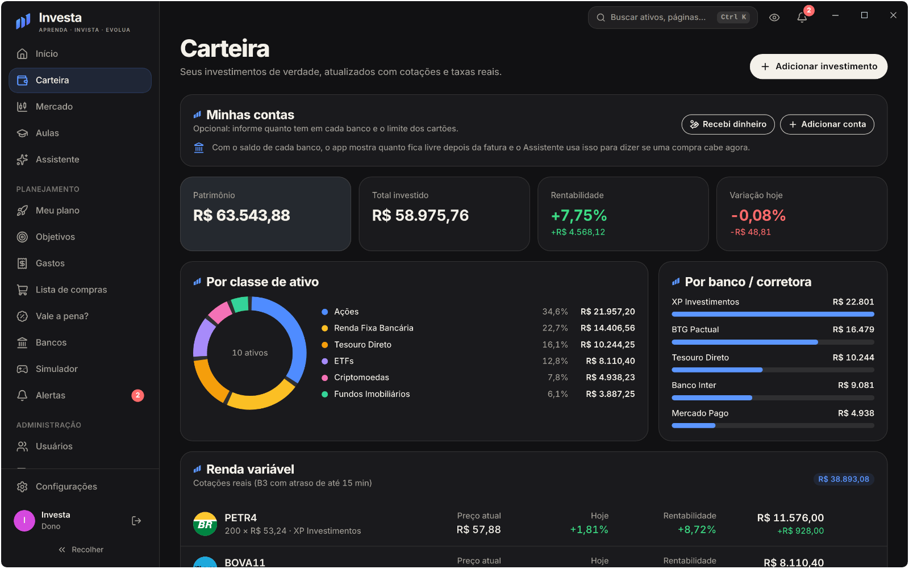 Carteira dividida por tipo de investimento</td>
    <td width="50%">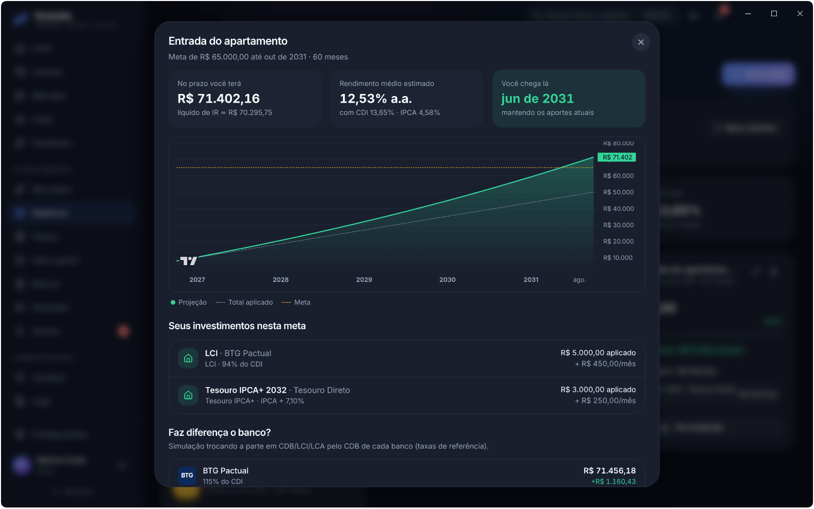 Projeção de uma meta</td>
  </tr>
  <tr>
    <td>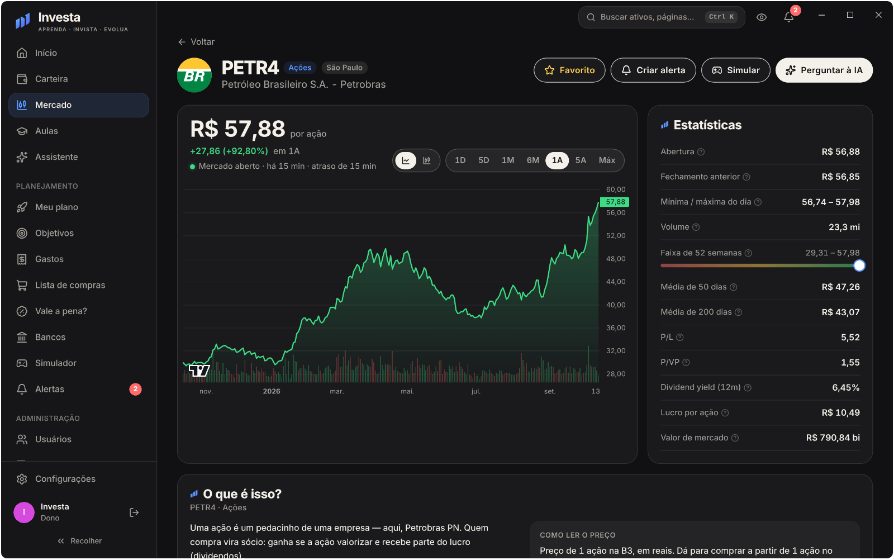 Página de um ativo com os indicadores explicados</td>
    <td>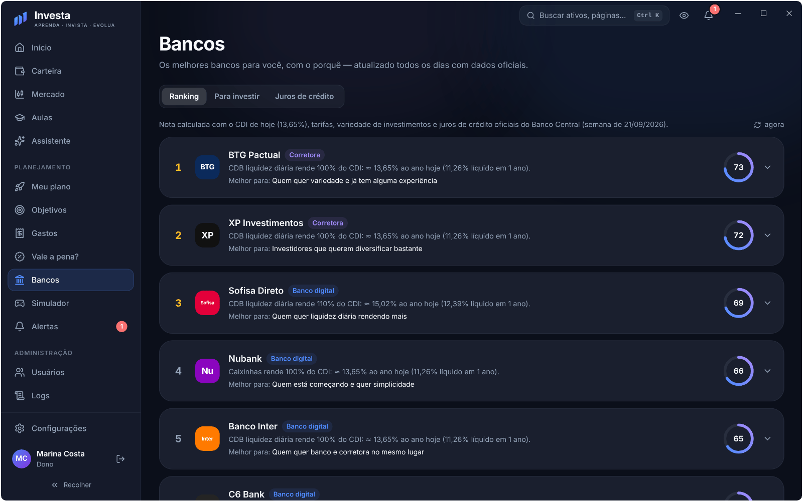 Comparação de bancos e corretoras</td>
  </tr>
  <tr>
    <td>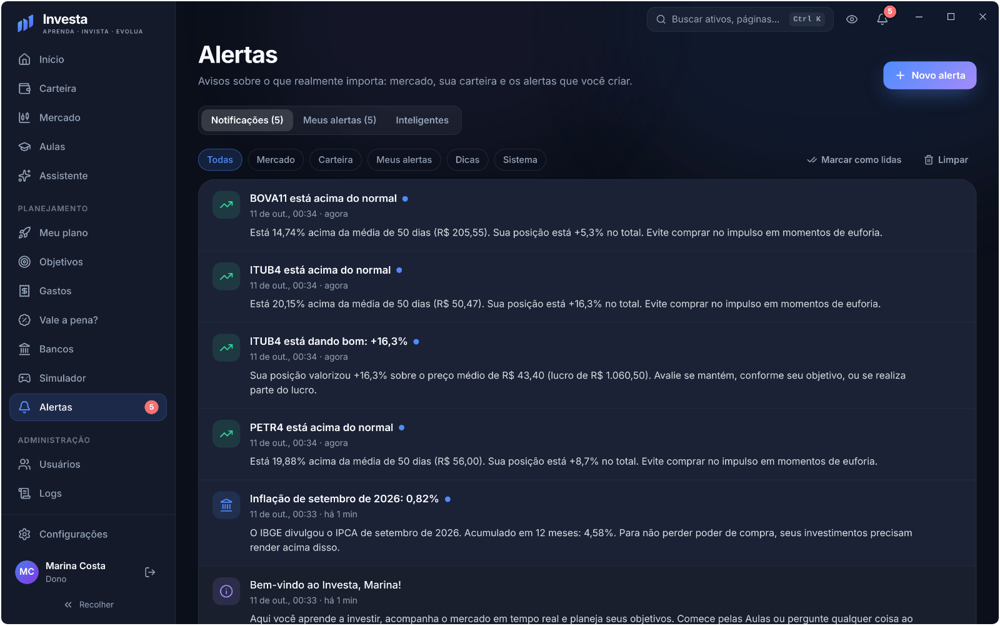 Alertas</td>
    <td>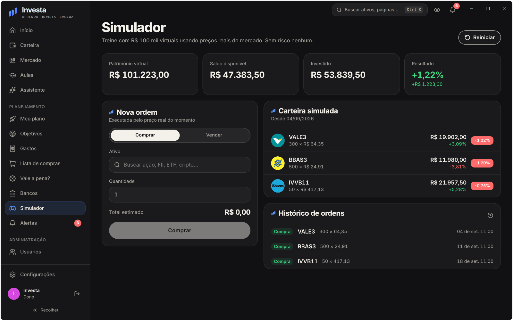 Simulador</td>
  </tr>
</table>

As imagens usam uma conta de demonstração. Os valores da carteira e dos gastos são fictícios.

## Download

Baixe a versão mais recente na página de [Releases](https://github.com/brunoosz/Investa/releases/latest).

| Arquivo | Para quê |
|---|---|
| `Investa-Setup-<versão>.exe` | Instalador para Windows 10 ou 11 |
| `Investa-Portatil-<versão>.exe` | Versão para Windows que roda sem instalar |
| `Investa-Android-<versão>.apk` | App para Android 7 ou mais novo |

**Windows:** o app não tem certificado de assinatura digital (é caro para um projeto pessoal), então o Windows pode mostrar "O Windows protegeu o computador". Clique em **Mais informações → Executar assim mesmo**.

**Android:** baixe o `.apk` pelo celular e abra o arquivo. Na primeira vez, o Android pede para permitir a instalação de apps de fora da Play Store.

Baixe os arquivos só pela página de Releases deste repositório.

## Feito com

React, TypeScript, Vite e Tailwind CSS na interface, Electron no Windows e Capacitor no Android.

## Limitações

- É um projeto de iniciante, então pode ter falhas. Se encontrar alguma, abra uma [issue](https://github.com/brunoosz/Investa/issues).
- As cotações da B3 podem ter até 15 minutos de atraso.
- Não há versão para iPhone.
- Nenhum app é 100% seguro. Problemas de segurança devem ser avisados em particular, como explicado no [SECURITY.md](SECURITY.md).

## Licença

Criado e mantido por **Bruno Camperlingo**. Distribuído sob a licença MIT. Veja o arquivo [LICENSE](LICENSE).
